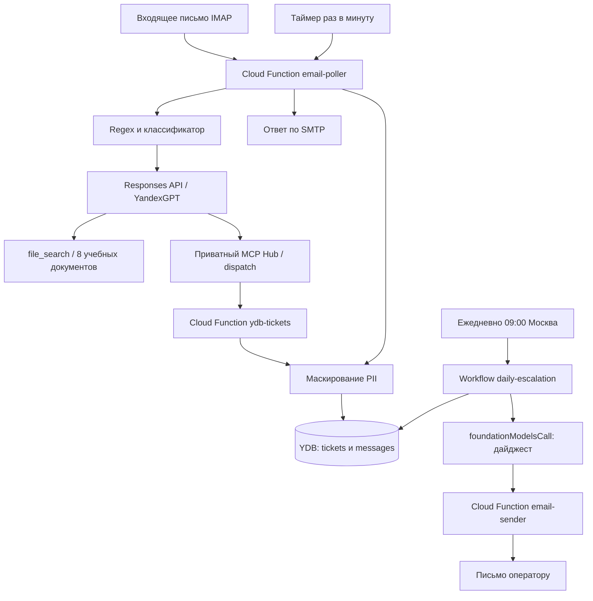

# AI-агент службы поддержки

[](https://github.com/ElenaIlyina/llm-developer-project-425/actions)

Учебный Help Desk на Yandex Cloud: ответы по демонстрационной базе знаний,
тикеты в YDB и ежедневная эскалация оператору.

## Проверка проекта

- Почта: **helpdesk-elena-project@yandex.ru**. Поллер проверяет непрочитанные письма раз в минуту: ожидание до 60 секунд плюс обработка моделью и доставка SMTP.
- [Репозиторий с конфигурациями](https://github.com/ElenaIlyina/llm-developer-project-425).
- [Агент в AI Studio](https://aistudio.yandex.ru/platform/folders/b1gu1oe70uop37it489m/runtime-agents/aac7c230uu7tlo9vhck0) — доступ зависит от прав на каталог. Почтовый обработчик вызывает Responses API с системным промптом из репозитория.
- [Подтверждения запусков и письма](docs/evidence/README.md); [финальный QA, токены и стоимость](docs/qa.md).

### Что попробовать

1. «У меня сломался принтер, что делать?»
2. Ответом в той же переписке: «Не помогло, создай тикет категории bug».
3. «Покажи мои тикеты».
4. «Какова точная сумма компенсации за занятия скалолазанием?» — информации в учебной базе нет; агент предлагает создать тикет и ждёт согласия.

Не отправляйте настоящие персональные данные: это учебная система.

## Архитектура



Поллер сохраняет переписку и метрики `tokens_in`, `tokens_out`, `latency_ms`
в YDB. MCP вызывает функцию тикетов; созданный ticket_id связывается с двумя
репликами текущего цикла. Тексты перед записью маскируются. Workflow формирует
дайджест просроченных заявок и переводит их в `escalated`.

## Состояние

| Возможность | Подтверждение / ограничение |
| --- | --- |
| Почта, создание и просмотр тикетов, история | Проверены реальными письмами и чтением YDB |
| RAG: известный и неизвестный вопрос | Проверены API и почтой; 8 демонстрационных документов |
| Эскалация | Дайджест доставлен, статус escalated подтверждён; повтор не отправляет тот же тикет |
| Injection и PII | Проверены классификатор, блокировка инструмента и маски в YDB |
| Логи платформы | CLI/UI недоступны в ограниченном режиме; отсутствие PII в облачных логах не подтверждено |
| Токены и история | usage точно совпадает с YDB; реплики создания связаны с настоящим тикетом |

По согласованию с преподавателем `aiStudioAgent` заменён на `foundationModelsCall`:
ID нового runtime-агента несовместим с ожидаемым `promptTemplateId`.
Дайджест получает системный промпт прямо в workflow; ID агента шага 3 не нужен.
Дайджест отправляется ежедневно в 09:00 Europe/Moscow.

## Контекст и защита

**Trusted:** системные промпты из репозитория, код и конфигурация инструментов.
**Untrusted:** входящие письма, From, архив переписки, найденные RAG-фрагменты
и аргументы, предложенные моделью. Они не могут менять правила или разрешать
действия. История передаётся как данные conversation_history внутри JSON;
текст обращения не подставляется в системный промпт. PII маскируется кодом.

## Локальная работа

Python 3.12, Yandex Cloud CLI и настроенный профиль нужного каталога:

```bash
python3.12 -m venv .venv
source .venv/bin/activate
pip install -r requirements-dev.txt
pip install -r requirements-rag.txt
yc init
python -m unittest discover -s tests -v
```

При первом запуске создайте `.env` по `.env.example`; существующий файл сохраняйте.
Заполните адреса и ID своих ресурсов. Для параметров проверки установите
`RAG_SCORE_THRESHOLD=0.35` и `GUARDRAIL_FAIL_OPEN=true`; шаблон содержит только имена.
Для нового каталога начните с создания YDB:

```bash
yc ydb database create help-desk-db --serverless
yc ydb database get help-desk-db
```

Дождитесь RUNNING. Endpoint и путь базы сохраните в Lockbox, затем создайте
схему и функции по связанным ниже инструкциям. В чужом каталоге ID функций,
базы и модели в конфигурациях нужно заменить на свои.
Пароли приложений и параметры YDB хранятся в Lockbox, функции получают IAM через
metadata service. Секреты, токены и `.env` не коммитятся.

- `src/`: поллер, инструменты тикетов, RAG, защита и SMTP-отправка.
- `prompts/`, `config/`, `schemas/`: промпты, тарифы для оценки и JSON-схема YaWL.
- `knowledge-base/`: учебные HR/IT-документы; `tests/`: локальные проверки.
- `scripts/`: настройка, деплой и диагностические команды.
- `docs/`: инструкции и подтверждения проверок.

Развёртывание: [почта](docs/email-workflow.md), [MCP и YDB](docs/tickets-and-history.md),
[эскалация](docs/daily-escalation.md), [RAG](docs/rag.md), [защита](docs/security.md).
Почта публично принимает обращения; облачные инструменты требуют авторизации.
Ограничения: адрес From не подтверждает корпоративную личность; отдельного ACL
сотрудников нет. Проверка согласия действует в почтовом маршруте. Полный отказ YDB
на изолированном облачном ресурсе не проверен; отдельные UI-фильтры модерации не подтверждены.
При сбое классификатора используется fail-open, regex остаётся активным.
Подробнее: [защита](docs/security.md) и [чек-лист сдачи](docs/submission.md).

---

<details>
<summary>Автоматические тесты Хекслета</summary>

Тесты запускаются на каждый коммит. За запуск отвечает файл `.github/workflows/hexlet-check.yml` — не удаляйте и не переименовывайте ни его, ни репозиторий.

</details>
